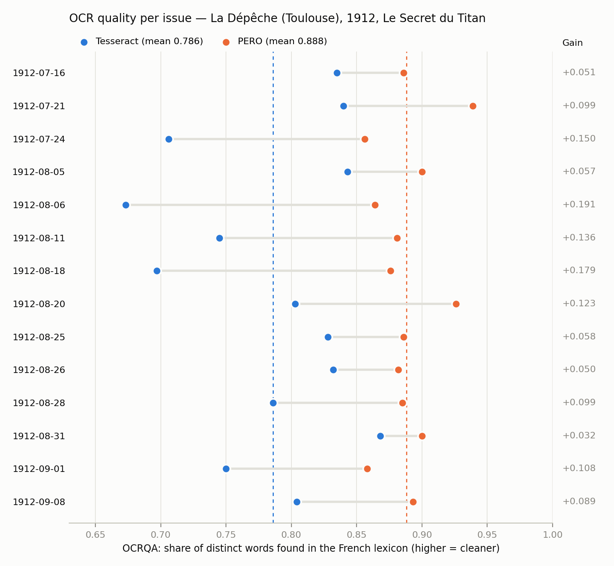

# OCR quality: Tesseract vs PERO OCR

Corpus: 14 issues of *La Dépêche* (Toulouse), 1912, feuilleton *Le Secret du Titan* (X. de Montépin). Each issue = the same column crops, transcribed by both engines.

## Headline

- **Mean OCRQA: Tesseract 0.786 → PERO 0.888** (mean gain +0.102, i.e. +10.2 points).
- PERO scores higher on **14 of 14 issues** (Tesseract higher on 0, ties 0); gain per issue ranges from +0.032 to +0.191. Exact sign test, two-sided: p = 0.00012.
- Both engines read about the same amount of text (1600 vs 1631 words per issue), so PERO's higher score is not explained by dropping hard passages.
- PERO produces fewer distinct word forms (744 → 709 per issue): fewer garbled variants of the same words.

## Summary table

| | Tesseract | PERO |
|---|---:|---:|
| Mean OCRQA (average of issues) | 0.786 | 0.888 |
| Median OCRQA | 0.804 | 0.885 |
| Std. deviation across issues | 0.062 | 0.023 |
| Worst issue | 0.673 | 0.856 |
| Best issue | 0.868 | 0.939 |
| Pooled OCRQA (all issues' types summed) | 0.785 | 0.888 |
| Words (tokens) per issue | 1,600 | 1,631 |
| Distinct words (types) per issue | 744 | 709 |
| Total tokens | 22,406 | 22,840 |
| Total types (summed per issue) | 10,410 | 9,925 |

## Per issue

| Issue date | Tesseract OCRQA | PERO OCRQA | Gain | Tesseract tokens / types | PERO tokens / types |
|---|---:|---:|---:|---:|---:|
| 1912-07-16 | 0.835 | 0.886 | +0.051 | 1,768 / 772 | 1,798 / 755 |
| 1912-07-21 | 0.840 | 0.939 | +0.099 | 1,614 / 738 | 1,604 / 688 |
| 1912-07-24 | 0.706 | 0.856 | +0.150 | 1,457 / 695 | 1,518 / 651 |
| 1912-08-05 | 0.843 | 0.900 | +0.057 | 1,686 / 800 | 1,685 / 770 |
| 1912-08-06 | 0.673 | 0.864 | +0.191 | 1,560 / 838 | 1,613 / 781 |
| 1912-08-11 | 0.745 | 0.881 | +0.136 | 1,562 / 715 | 1,589 / 670 |
| 1912-08-18 | 0.697 | 0.876 | +0.179 | 1,596 / 804 | 1,698 / 736 |
| 1912-08-20 | 0.803 | 0.926 | +0.123 | 1,451 / 684 | 1,490 / 637 |
| 1912-08-25 | 0.828 | 0.886 | +0.058 | 1,555 / 703 | 1,593 / 694 |
| 1912-08-26 | 0.832 | 0.882 | +0.050 | 1,585 / 691 | 1,606 / 679 |
| 1912-08-28 | 0.786 | 0.885 | +0.099 | 1,655 / 779 | 1,655 / 737 |
| 1912-08-31 | 0.868 | 0.900 | +0.032 | 1,650 / 713 | 1,696 / 723 |
| 1912-09-01 | 0.750 | 0.858 | +0.108 | 1,678 / 713 | 1,670 / 682 |
| 1912-09-08 | 0.804 | 0.893 | +0.089 | 1,589 / 765 | 1,625 / 722 |

## What the columns mean

Before counting, each text is normalised the way the Impresso model expects: lowercased, punctuation replaced by spaces, digits replaced by 0, then split on spaces.

- **tokens** — every word the engine produced, repeats included. If *de* occurs 80 times, that is 80 tokens. It measures *how much* text the engine read.
- **types** — the *distinct* words among those tokens. The 80 *de* count once. Each misspelling (*interrogutoire*, *interrogatoirc*) is a new type, so noisy OCR inflates the type count.
- **known_types** — the types found in the French lexicon.
- **ocrqa** = known_types / types — the share of distinct words that are real French words. 1.0 = every distinct word is in the lexicon.
- **Gain** (delta) = PERO OCRQA − Tesseract OCRQA on the same issue.
- **Mean OCRQA** averages the per-issue scores (each issue weighs the same); **pooled OCRQA** divides all known types by all types, so longer issues weigh more.

Toy example: *« le lecteur lit le journal journl »* → 6 tokens, 5 types (le, lecteur, lit, journal, journl), 4 known → OCRQA = 4/5 = 0.80.

## Caveats

- OCRQA needs no reference transcription, so it is **not a character error rate**: a misreading that yields another real word (*mère* → *mer*) counts as correct, while proper names and old spellings absent from Wikipedia count as errors. Both engines face the same text, so the comparison is fair; the absolute values are approximate.
- It ignores missing text — hence the token counts above, which are similar for both engines.
- The lexicon is a Bloom filter: a small share of garbage strings are wrongly accepted, which lifts both engines' scores slightly and equally.
- Line-end hyphenation is left as is (Tesseract lost most hyphens), so word fragments penalise both engines alike.
